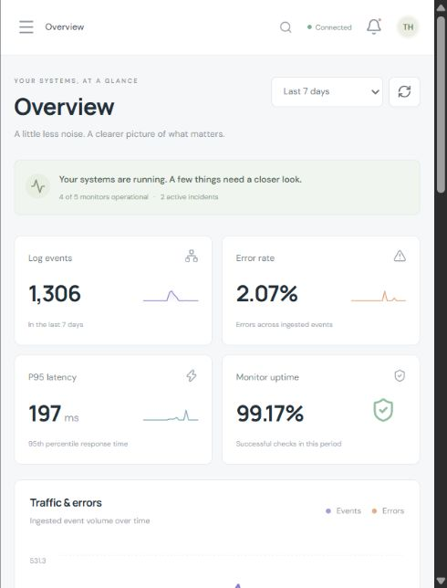
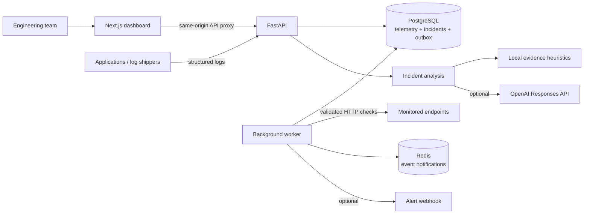

<div align="center">

# TraceHunt AI

**Find the signal. Understand the incident.**

An observability workspace for API health, application logs, anomaly detection, and evidence-based incident investigation.

[](https://github.com/manikantbindass/Tracehunt/actions/workflows/ci.yml)
[](LICENSE)


[Quick start](#quick-start) · [Capabilities](#capabilities) · [Architecture](#architecture) · [API](#api) · [Development](#development) · [Deployment](#deployment)

</div>

---

TraceHunt brings service health, logs, releases, and incident evidence into one place. Monitor HTTP endpoints, ingest structured events, detect error bursts, and investigate failures with a timeline and a reviewable root-cause hypothesis.

The repository includes a functional Next.js application, a FastAPI backend, persistent SQL storage, a background worker, Docker Compose, database migrations, tests, and CI. A seeded demo runs without cloud credentials. Optional OpenAI integration enriches investigations; local heuristic analysis is available without an API key.

> **Scope:** This release is a single-workspace application and development foundation. The demo is intentionally open on localhost. Shared API-key authentication is available for a private deployment; multi-tenant identity, SSO, RBAC, distributed tracing, and automatic remediation are not implemented.

## Live application preview

Captured from TraceHunt running locally at `http://127.0.0.1:3001` on 24 October 2026. The screenshot shows the demo workspace with the **Last 7 days** view selected; displayed telemetry includes synthetic demo and smoke-test records.

[](docs/images/tracehunt-overview.jpg)

[View the full dashboard screenshot](docs/images/tracehunt-overview.jpg)

## Project guide and presentation

- [Complete project guide (PDF, 24 pages)](docs/project-overview/TraceHunt-AI-Project-Guide.pdf)
- [Project presentation (PowerPoint, 24 slides)](docs/project-overview/TraceHunt-AI-Project-Presentation.pptx)

Both explain the problem, solution, architecture, ingestion, monitoring, incident rules, AI analysis, database, reliability, setup, security, and roadmap. The PowerPoint includes detailed speaker notes, editable diagrams, and editable charts. Graphs use clearly labeled illustrative data, not measured performance results. See the [document index](docs/project-overview/README.md) for topic navigation and source details.

## Capabilities

| Area | Included behavior |
| --- | --- |
| Operations overview | Time-window metrics, request/error trends, service health, active incidents, and recent deployments |
| API monitoring | Create, pause, resume, check, and delete HTTP monitors; expected status and latency thresholds; stored check history |
| Log explorer | Structured single/batch ingestion; level, service, and text filtering; trace identifiers and metadata |
| Anomaly detection | Error-burst and monitor-failure rules with persistent deduplication and a cooldown |
| Incident management | Open, investigate, resolve, and reopen incidents; chronological activity and correlated evidence |
| Incident intelligence | Local evidence-based hypotheses or optional OpenAI structured analysis; explicit source and suggested next steps |
| Deployment tracking | Record versions and release outcomes, and correlate preceding releases with incidents |
| Event processing | SQL outbox, worker processing, Redis notifications, retry handling, and optional incident webhooks |
| Operational visibility | Audit history, readiness/liveness endpoints, and Prometheus-format metrics |
| Developer experience | SQLite development mode, PostgreSQL/Redis Compose stack, synthetic telemetry generator, tests, and GitHub Actions |

Sample records are synthetic and labeled as demo data. Sample monitors never contact external endpoints. Real monitors perform HTTP requests after validation.

## Quick start

### Docker Compose

Install Docker with the Compose plugin and start its **Linux container engine**.

```bash
git clone https://github.com/manikantbindass/Tracehunt.git
cd Tracehunt
cp .env.example .env
docker compose up --build -d --wait
```

PowerShell users can replace `cp` with `Copy-Item .env.example .env`.

- **Dashboard:** <http://localhost:3000>
- **Interactive API documentation:** <http://localhost:8000/docs>
- **Liveness:** <http://localhost:8000/health>
- **Readiness:** <http://localhost:8000/ready>

The API applies migrations before starting. PostgreSQL and Redis use persistent volumes and are not published to the host. Web and API ports bind to localhost.

```bash
docker compose logs -f api worker
docker compose down
```

`docker compose down` preserves data. Add `--volumes` only when you intend to erase the local database and Redis data.

### Try the workflow

1. Open **Overview** and inspect the seeded payment-service incident.
2. Open **Incidents**, select an incident, and run an investigation. The result identifies whether it came from heuristics or OpenAI.
3. Open **Logs** and filter by service, severity, or message.
4. Create a real public HTTP monitor in **Monitors**. Configure its expected status, check interval, and latency threshold.
5. Record a release in **Deployments** and generate sample events:

```bash
python scripts/generate_events.py --service checkout-api --count 40 --error-rate 0.4
```

With the worker running, an error burst opens an incident. Investigate it, review the evidence, and mark it resolved. The generator writes synthetic data; run it only against a workspace intended for test events.

## Architecture



SQL is the durable source of truth. The worker processes persisted events and evaluates monitors; Redis Streams supports worker delivery without replacing database durability. The dashboard refreshes through API polling, while the optional server-sent events endpoint reads the SQL audit trail. SQLite is a lightweight local alternative to PostgreSQL.

Read [system design](docs/architecture/system-design.md) for event processing, failure behavior, and scaling limits, and [the API guide](docs/modules/api.md) for request examples.

## Repository layout

```text
Tracehunt/
├── apps/
│   ├── api/                  # FastAPI, SQLAlchemy, Alembic, worker, tests
│   └── web/                  # Next.js App Router, TypeScript, dashboard UI
├── ops/                      # Multi-stage web and non-root API Dockerfiles
├── scripts/
│   ├── generate_events.py    # Finite synthetic telemetry generator
│   └── smoke.py              # End-to-end API contract verification
├── docs/
│   ├── architecture/         # System design and operational boundaries
│   └── modules/              # API usage and operator runbook
├── .github/workflows/ci.yml  # Tests, build, migrations, Docker smoke test
├── compose.yaml
├── .env.example
├── CONTRIBUTING.md
├── SECURITY.md
└── LICENSE
```

## Development

Requirements: **Python 3.12+**, **Node.js 22+**, and npm. Docker is optional for SQLite development.

### API

```bash
cd apps/api
python -m venv .venv
# macOS / Linux
source .venv/bin/activate
# Windows PowerShell
# .\.venv\Scripts\Activate.ps1
python -m pip install -e ".[dev]"
alembic upgrade head
uvicorn app.main:app --reload --host 127.0.0.1 --port 8000
```

On Windows with multiple Python versions, use `py -3.12 -m venv .venv`.

The migration command initializes the local SQLite database, and the API seeds demo records. For custom configuration, copy the root `.env.example` to `apps/api/.env` before running migrations. Leave `DATABASE_URL` unset for SQLite. Root `.env` is used by Compose; the local API reads `.env` relative to its working directory.

Apply migrations before the first API or worker start. If you previously launched demo mode directly and have an unversioned database, use a fresh database or follow the [migration guidance](docs/modules/operations.md); do not blindly stamp an existing schema.

### Worker

In another terminal, activate the same Python environment, enter `apps/api`, and run:

```bash
python -m app.worker
```

The API and worker must use the same database URL. The worker is required for scheduled monitoring, anomaly processing, and webhook delivery. For a single-process local demo, `RUN_WORKER=true` starts it with the API; do not also start a separate worker unless intentionally testing concurrent processing.

### Frontend

```bash
cd apps/web
npm ci
npm run dev
```

Open <http://localhost:3000>. Next.js proxies `/api/v1/*` to `http://127.0.0.1:8000` by default. `API_INTERNAL_URL` changes the proxy target and must be set **before building** the frontend because rewrites are compiled into the build. Compose supplies `http://api:8000` automatically.

The **Settings** screen can configure a direct API connection and a workspace key. The key is held in browser session storage. Direct connections require matching CORS origins on the API.

For a local production build, run `npm run build`, then `npm start`. The start script copies static assets into Next.js standalone output and binds to localhost. If port 3000 is occupied, use `npm start -- --port 3001` and open <http://localhost:3001>. The same-origin API proxy works on either port.

### Verification

```bash
# From apps/api
python -m pytest -q
alembic upgrade head

# From apps/web
npm run typecheck
npm run build

# From the repository root, with API running
python scripts/smoke.py
# Include background anomaly detection and automatic analysis (requires worker)
python scripts/smoke.py --worker
```

Smoke tests create clearly named synthetic records, resolve their incident, and remove their temporary monitor. Run them against a disposable development database. Set `TRACEHUNT_API_URL` and `TRACEHUNT_API_KEY` to target a different API.

GitHub Actions runs backend tests, a migration check, frontend type checking/build, and a full Compose smoke test. Dependabot checks dependencies weekly.

## Configuration

| Variable | Default | Purpose |
| --- | --- | --- |
| `DEMO_MODE` | `true` | Enables localhost demonstration without API-key authentication |
| `SEED_DEMO` | `true` | Seeds synthetic data in demo mode |
| `API_KEY` | empty | Shared workspace key; must be at least 24 characters when demo mode is disabled |
| `DATABASE_URL` | `sqlite:///./tracehunt.db` | SQLAlchemy database URL; Compose supplies PostgreSQL |
| `REDIS_URL` | empty | Optional Redis connection; Compose supplies its internal service |
| `CORS_ORIGINS` | localhost ports 3000 | JSON list of allowed dashboard origins |
| `RUN_WORKER` | `false` | Runs a worker inside the API process for local development |
| `OPENAI_API_KEY` | empty | Enables external model-based incident analysis |
| `OPENAI_MODEL` | `gpt-4.1-mini` | Configurable Responses API model supporting structured output |
| `ALERT_WEBHOOK_URL` | empty | Optional incident notification destination |
| `MONITOR_ALLOW_PRIVATE_NETWORKS` | `false` | Allows private endpoint monitoring only when deliberately enabled |
| `ERROR_THRESHOLD` | `5` | Error events required to trigger a service error burst |
| `ERROR_WINDOW_SECONDS` | `300` | Rolling error evaluation window |
| `INCIDENT_COOLDOWN_SECONDS` | `900` | Minimum interval between new incidents for a repeated rule |
| `MAX_BODY_BYTES` | `1048576` | Maximum request body size |
| `RETENTION_DAYS` | `30` | Worker retention window for telemetry |

For Docker-specific settings, see `.env.example`. If you customize database credentials, URL-encode reserved characters when embedding them in `DATABASE_URL`.

### Optional AI analysis

Set `OPENAI_API_KEY` in the API/worker environment and restart the service. The key stays on the backend. Analysis includes a summary, probable cause, confidence, evidence, and suggested actions; it never executes remediation.

The integration uses the [OpenAI Responses API](https://platform.openai.com/docs/api-reference/responses) with [structured outputs](https://platform.openai.com/docs/guides/structured-outputs). Correlated incident evidence is sent to the configured provider only when this integration is enabled. Review your data handling policy first. Sensitive-field redaction is best effort and does not guarantee removal of all confidential information.

If the provider is unavailable or the key is absent, the application returns a labeled heuristic result. Confidence is a heuristic/model estimate, not a calibrated probability or proof of root cause.

## API

All application endpoints are under `/api/v1`. Send `X-API-Key` when demo mode is off. Live API schemas are available at `/docs`.

```bash
curl -X POST http://localhost:8000/api/v1/logs \
  -H 'Content-Type: application/json' \
  -d '{"service":"checkout-api","level":"ERROR","message":"Database connection pool exhausted","trace_id":"trace-001","metadata":{"release":"v1.2.0"}}'
```

```bash
curl -X POST http://localhost:8000/api/v1/deployments \
  -H 'Content-Type: application/json' \
  -d '{"service":"checkout-api","version":"v1.2.0","environment":"production","status":"success","commit_sha":"a1b2c3d"}'
```

| Route | Use |
| --- | --- |
| `GET /overview` | Aggregated metrics and trend buckets; optional `hours` window |
| `GET/POST /monitors` | List and create monitors |
| `PATCH/DELETE /monitors/{id}` | Pause/resume or remove a monitor |
| `POST /monitors/{id}/check` | Run an immediate health check |
| `GET/POST /logs` | Search or ingest a structured log |
| `POST /logs/batch` | Ingest a bounded batch of logs |
| `GET/POST /incidents` | Search or create incidents |
| `GET/PATCH /incidents/{id}` | Read a timeline or update incident status |
| `POST /incidents/{id}/analyze` | Generate an evidence-based investigation |
| `GET/POST /deployments` | List or record releases |
| `GET /audit` | Workspace activity history |
| `GET /settings` | Non-secret runtime configuration |
| `GET /events` | Server-sent workspace update notifications |

`GET /health`, `GET /ready`, and `GET /metrics` are operational endpoints outside the versioned API. See the [API guide](docs/modules/api.md) for validation limits and integration details.

## Deployment

Start with Compose on a private host. Before making it accessible outside localhost:

1. Set `DEMO_MODE=false`, `SEED_DEMO=false`, and a long random `API_KEY`.
2. Replace local database credentials and configure persistent backups.
3. Put the dashboard/API behind HTTPS and authenticated access or a private network.
4. Configure allowed origins, gateway request limits, outbound network restrictions, and alert delivery.
5. Apply `alembic upgrade head` during deployment and verify `/ready` before routing traffic.
6. Monitor worker health and storage growth; define retention and incident-response ownership.

The API refuses to start in non-demo mode without a sufficiently long key. Public/private destination validation, redirect blocking, and outbound address pinning reduce SSRF exposure. These do not replace a network egress policy.

Read [SECURITY.md](SECURITY.md) and the [operator runbook](docs/modules/operations.md) before deployment. Kubernetes, managed cloud infrastructure, SSO, distributed tracing, and production capacity qualification remain future work; this repository does not claim those integrations.

## Roadmap

- [x] API monitoring, structured logs, incident lifecycle, and release correlation
- [x] Evidence-based local analysis and optional OpenAI analysis
- [x] Durable event worker, Redis integration, webhook delivery, and audit history
- [x] Responsive dashboard, database migrations, Docker Compose, and CI
- [ ] Organization accounts, SSO, scoped tokens, and RBAC
- [ ] OpenTelemetry trace collection and service dependency graphs
- [ ] Configurable SLOs, adaptive anomaly baselines, and alert routing policies
- [ ] Kubernetes/Helm deployment and load-tested horizontal scaling
- [ ] External incident integrations and approved remediation playbooks

## Contributing and license

See [CONTRIBUTING.md](CONTRIBUTING.md) for development conventions and [PROGRESS.md](PROGRESS.md) for implementation status. Licensed under the [MIT License](LICENSE).
