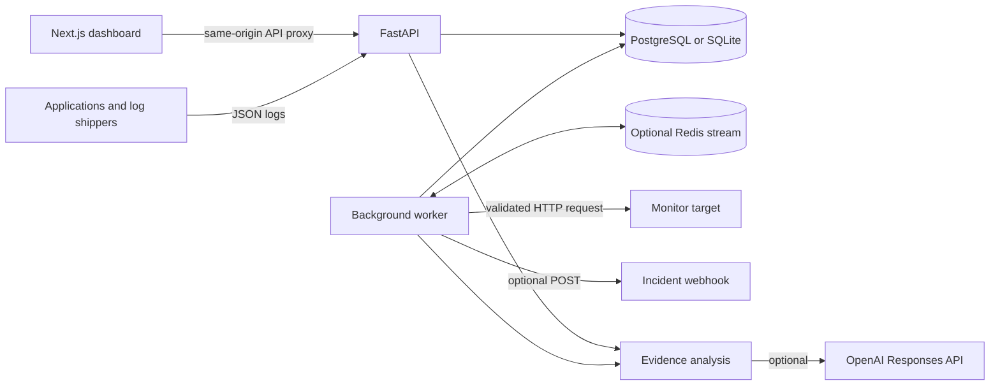

# System design

TraceHunt is a single-workspace observability application. It stores structured logs, HTTP monitor checks, incidents, releases, and activity in SQL. A worker evaluates persisted events and scheduled monitors. The dashboard provides an operator view of that data.

This document describes the implementation in this repository. It does not imply a production capacity guarantee, calibrated anomaly model, or multi-tenant isolation.

## Components and data flow

| Component | Responsibility |
| --- | --- |
| `apps/web` | Next.js dashboard, connection settings, browser requests, and a same-origin `/api/v1/*` proxy |
| `apps/api/app/main.py` | Request validation, shared-key authentication, query endpoints, mutations, health, metrics, and activity stream |
| `apps/api/app/services.py` | Monitor execution, log ingestion, incident rules, evidence correlation, and analysis |
| `apps/api/app/worker.py` | Monitor scheduling, SQL event claims, optional Redis delivery, retries, and retention |
| SQL database | Authoritative application data and transactional outbox |
| Redis | Optional stream transport for event identifiers; SQL remains authoritative |

The API and worker must share the same database. Redis is used by the worker, not as a direct browser notification channel. The dashboard refreshes data through API requests. The separate SSE endpoint polls the SQL audit table every three seconds; it does not subscribe to Redis.

## Persistent model

| Table | Stored information |
| --- | --- |
| `monitors` | Target URL, method, thresholds, enabled/demo flags, latest result, and next check time |
| `monitor_checks` | Individual status, latency, status code, and error results |
| `logs` | Service, normalized severity, message, optional trace ID, metadata, and ingestion time |
| `incidents` | Severity, lifecycle status, rule fingerprint, summary, latest analysis, and timestamps |
| `incident_timeline` | Incident creation, status changes, and analysis activity |
| `deployments` | Service, version, environment, outcome, optional commit SHA, and recording time |
| `audit` | System/operator activity; the actor is a label, not an authenticated person |
| `events` | Durable event payload, attempt count, availability, lease, and processed flag |
| `rule_states` | Persistent rule cooldown and last incident reference |

Identifiers are UUID strings. Server timestamps are UTC and returned with a `Z` suffix. Log and deployment times are assigned on ingestion; the API does not accept a source timestamp for historical import. A `trace_id` groups searchable records but is not distributed trace collection.

SQLAlchemy supports SQLite for local work and PostgreSQL for the Compose deployment. SQLite enables WAL and a busy timeout. Demo startup can create tables and seed data; non-demo deployments require Alembic migrations. Relationships are represented by IDs in this schema, without database foreign-key cascades; monitor deletion explicitly deletes its check rows.

## Ingestion and incident detection

1. A log request is validated and selected message/metadata fields receive best-effort secret redaction.
2. The log is inserted. `ERROR` and `FATAL` records also insert a `log.error` event in the same transaction.
3. The worker counts recent error logs for that service at processing time. The default threshold is five in the last 300 seconds.
4. A rule fingerprint serializes incident creation using a `rule_states` row. An active incident suppresses new incidents for that rule; after resolution, the default 900-second cooldown is measured from the previous incident's creation.
5. Incident creation stores a timeline entry, audit record, and `incident.created` event atomically.
6. Processing that event creates an analysis if absent and queues a webhook delivery when configured. Otherwise, it records an in-app alert activity.

Error-burst severity is `high`, rising to `critical` at three times the threshold. Monitor failures use a fingerprint per monitor: `down` opens a critical incident and `degraded` opens a medium incident. Repeated events do not update the active incident's severity or append every matching log to its timeline. Recovery does not automatically resolve incidents; an operator changes their status.

Rule evaluation uses ingestion timestamps and the current time. If processing is delayed beyond the error window, an old burst may no longer satisfy the rule. This is a fixed-window threshold detector, not a learned baseline or a guarantee of event-time processing.

## Monitor execution

Monitors support `GET` and `HEAD`, a single expected HTTP status, and a latency threshold. A different status or request error means `down`; a matching status with excess latency means `degraded`; otherwise the result is `up`.

Latency measures the request through receipt of response headers. Response bodies are not downloaded. Uptime is the proportion of checks that matched the expected status in the selected overview window, or the last 24 hours in the monitor listing; a slow but status-matching check still counts as successful. No checks yields a displayed uptime of 100%, which should not be interpreted as measured availability.

The worker executes enabled, non-demo monitors when due. Checks run sequentially, so intervals are scheduling targets rather than precise deadlines. A manual check can run even when a monitor is paused. Sample monitors return deterministic synthetic results on manual checks and never issue network requests; the scheduler skips them.

HTTP destinations are validated again before execution, DNS addresses are checked and pinned for the request, redirects and environment proxies are disabled, and TLS verification remains enabled. See [security boundaries](../../SECURITY.md) for the allowed schemes, ports, and private-network behavior.

## Worker reliability

The worker sweeps SQL even when Redis is configured. It handles up to 20 due monitors and 50 available events per tick, with a two-second wait between ticks. Work can take longer than that wait.

Events are claimed with a conditional SQL update and a two-minute lease. The claim increments the attempt count before running the handler. Success marks the event processed in the same transaction as its database side effects. A crashed process leaves a lease that another worker can recover after expiry. Rule-state locking provides persistent deduplication for concurrent anomaly creation.

When configured, Redis uses the `tracehunt:events` stream and `workers` consumer group. SQL identifiers, not full log bodies, are transported. Redis failures are logged and the SQL sweep continues. Redis is therefore optional for correctness and is not the sole durable queue.

Failed events are rescheduled with exponential delays, capped at 300 seconds. After five attempts they are marked processed and an `event.failed` audit record is written. There is no separate dead-letter queue or replay endpoint. An exhausted event is no longer included in the pending-event metric.

Webhook delivery is at least once: a receiver may accept a request before a worker crashes or fails to commit. Receivers should deduplicate using `event_id`. There is no distributed transaction with an HTTP destination and no webhook signature or custom authorization-header support.

## Evidence and analysis

Analysis uses up to 30 recent logs for the incident's exact service within 30 minutes before to one hour after incident creation. It also includes up to three deployments for that service in the preceding two hours. The local analyzer recognizes a few patterns such as connection pressure, timeouts, and rate limiting; otherwise it reports insufficient evidence. Correlation is not proof of causation.

When `OPENAI_API_KEY` is set, both manual analysis and automatic worker analysis may send the incident and correlated evidence to the configured OpenAI model. The request uses a structured result schema and `store=False`. Missing credentials, provider failures, or unusable responses leave a labeled heuristic result. Analysis records `source` and `generated_at`, and replaces the previous analysis on the incident. Older full analysis results are not versioned, although timeline activity is retained.

No analysis executes a command, changes infrastructure, or performs a rollback. Confidence is an uncalibrated estimate. The backend redacts selected fields and the provider payload, but operators must remove sensitive content before ingestion; regex redaction cannot guarantee confidentiality.

## Read views and operational limits

Overview request counts are counts of ingested log records, not independently measured HTTP traffic. Error rate is the proportion of `ERROR`/`FATAL` records. Latency uses numeric `metadata.latency_ms`, falling back to monitor checks when no log latencies are available. The view has 24 time buckets and supports windows from one to 168 hours.

Aggregation loads at most 50,000 logs/checks. Total log and error counts are separate database counts; charts, service summaries, and percentiles may cover a bounded sample. `sampled` reports when the log limit is exceeded. There is no long-term rollup store, cursor pagination, or dedicated search engine.

Retention runs in the worker approximately hourly and removes old logs, checks, audit rows, and processed events. Incidents, timelines, deployments, rule state, and unprocessed events are not removed by this policy. Growing storage, worker delays, and missing checks require external monitoring.

`/ready` checks database connectivity and the monitor table. It does not prove Redis connectivity, worker liveness, webhook delivery, or schema compatibility beyond that query. The four application metrics are current database gauges, not a full instrumentation suite.

The current deployment has one shared API key, no users or tenant boundaries, no SSO/RBAC, no tracing collector, no automatic remediation, and no qualified horizontal scaling or high-availability design. See the [operator runbook](../modules/operations.md) before adapting it for a private deployment.
